# STM32F103C8T6 移植 uC/OS-III：多任务点灯与 AHT20 温湿度采集

> 硬件：STM32F103C8T6 最小系统板  
> 软件：STM32CubeMX 6.16.1、Keil MDK 5.38（ARMCC 5.06）、STM32F1 HAL V1.8.7、uC/OS-III V3.08.02  
> GitHub 仓库：<https://github.com/clzzzs/stm32f103-ucosiii-aht20-lab>  
> 博客地址：<https://blog.csdn.net/2401_89763261/article/details/169743384>  

---

## 1. 实验目的

1. 理解 RTOS 的任务、优先级、任务栈、系统节拍和抢占式调度；
2. 掌握 uC/OS-III 在 STM32F103C8T6 上的移植方法；
3. 用 uC/OS-III 创建 3 个任务，完成 1 s LED、3 s LED 和 2 s 串口发送；
4. 理解 I2C 协议，区分软件 I2C 和硬件 I2C；
5. 阅读 AHT20 数据手册，完成温湿度采集并集成到 RTOS 任务中；
6. 能说明 AHT20 的 I2C 地址、初始化命令、测量命令和读数据时序。

---

## 2. 实验环境

MCU 为 STM32F103C8T6，Cortex-M3，64 KB Flash、20 KB SRAM，外部 8 MHz 晶振经 PLL 倍频到 72 MHz。下载器为 ST-Link V2，串口使用 USB 转 TTL（CH340），波特率 115200、8N1。传感器为 AHT20 温湿度模块，7 位 I2C 地址 0x38；两个 LED 分别接 PA5、PA6。


---

## 3. 系统设计

任务一建立 3 个任务：

- `led1_task`：优先级 4，每 1 s 翻转 PA5；
- `led2_task`：优先级 5，每 3 s 翻转 PA6；
- `uart_task`：优先级 6，每 2 s 通过 USART1 发送指定字符串。

任务二保留两个 LED 任务，把第 3 个任务改成 `aht20_task`：每 2 s 采集一次 AHT20，并通过 USART1 输出温度和湿度。

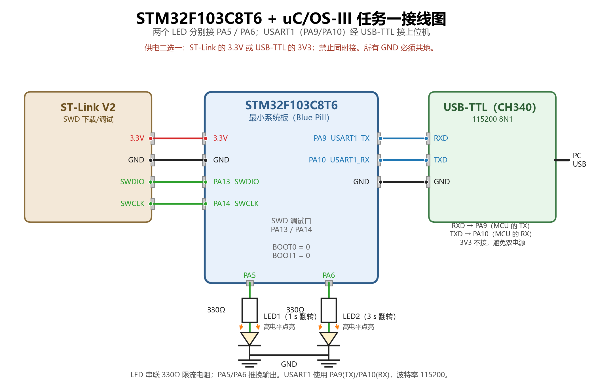

*图 1　任务一硬件接线图*

---

## 4. 硬件接线

任务一：

- PA5 → 330 Ω → LED1 阳极，LED1 阴极 → GND；
- PA6 → 330 Ω → LED2 阳极，LED2 阴极 → GND；
- PA9 → USB-TTL RXD，PA10 → USB-TTL TXD；
- ST-Link：3.3V、GND、SWDIO→PA13、SWCLK→PA14；
- ST-Link 的 3.3V 与 USB-TTL 的 3V3 只能接一个，所有 GND 共地。

任务二在此基础上增加 AHT20：

- AHT20 1 脚 VDD → 3.3V；
- 2 脚 SDA → PB7；
- 3 脚 GND → GND；
- 4 脚 SCL → PB6；
- SDA/SCL 若模块没有上拉，各接 4.7 kΩ 到 3.3V。

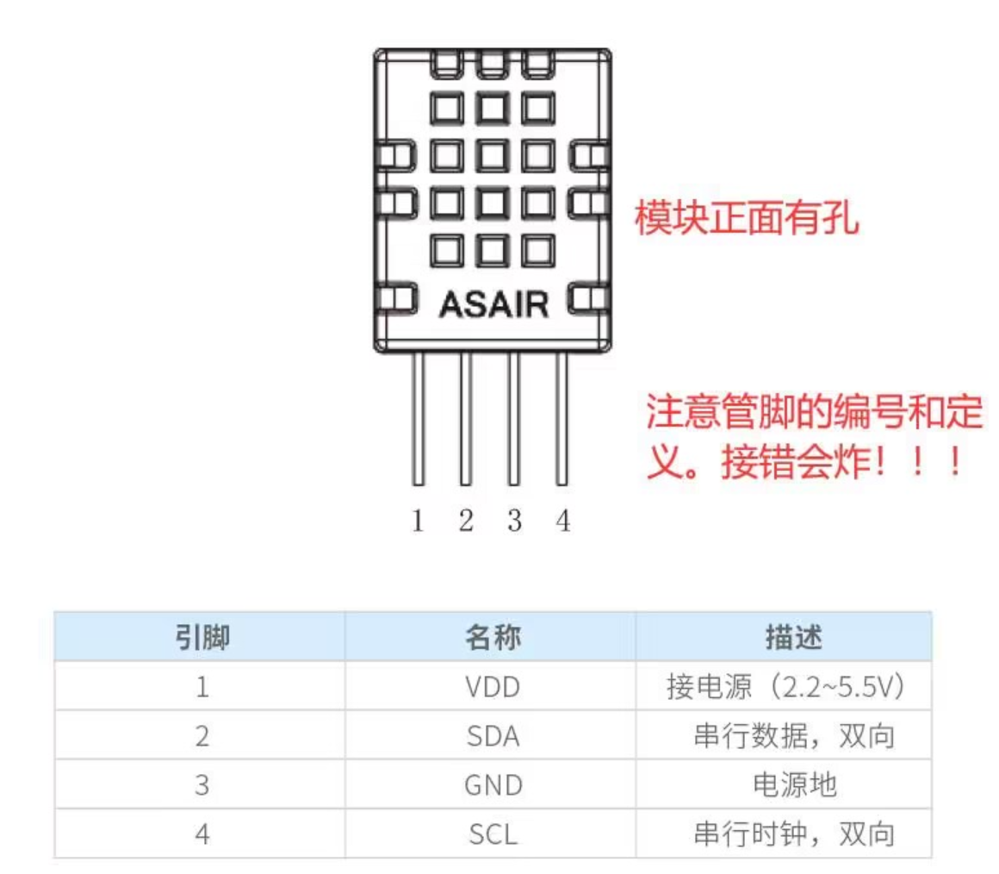

*图 2　AHT20 模块引脚定义*

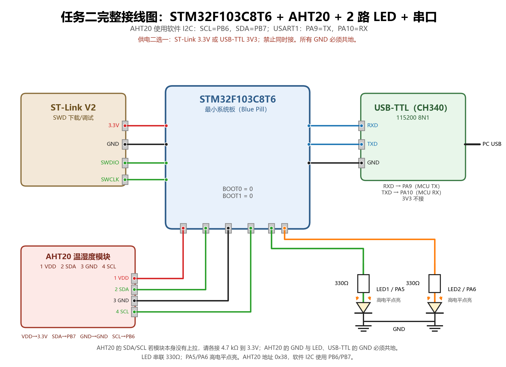

*图 3　任务二完整接线图*

---

## 5. uC/OS-III 下载与移植过程（详细）

整个移植过程可以概括为：CubeMX 建工程 → 下载官方源码 → PowerShell 复制文件 → Keil 加入文件组和头文件路径 → 修改启动文件与配置 → 编译验证。

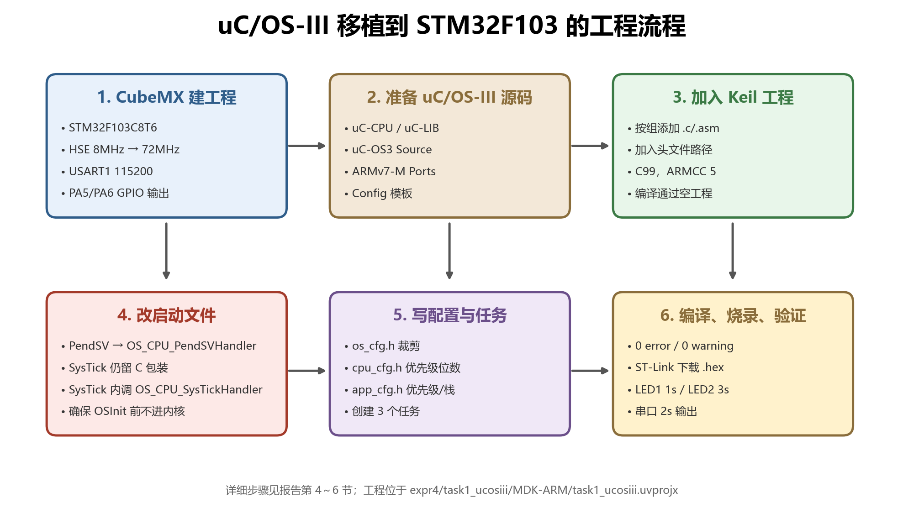

*图 4　uC/OS-III 移植流程图*

### 5.1 下载源码

用浏览器打开以下三个官方仓库，分别点 `Code → Download ZIP`：

- <https://github.com/weston-embedded/uC-OS3>
- <https://github.com/weston-embedded/uC-CPU>
- <https://github.com/weston-embedded/uC-LIB>

解压到：

```text
F:\Fundamentals_of_Embedded_Systems\expr4\third_party
```

解压后文件夹改名为：

```text
third_party\
├── uC-OS3\
├── uC-CPU\
└── uC-LIB\
```

其中 `uC-OS3` 要包含 `Source`、`Ports`、`Cfg` 三个目录，`uC-CPU` 要包含 `cpu_core.c`，`uC-LIB` 要包含 `lib_def.h`。

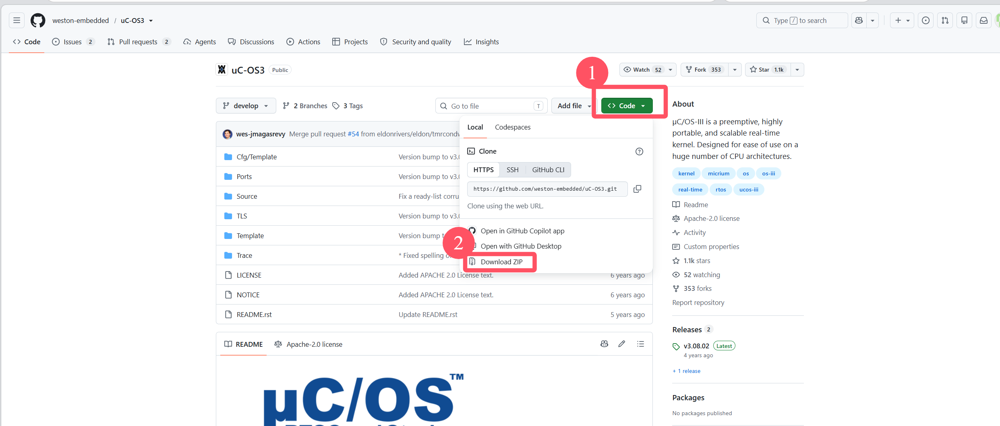

*图 5　GitHub 下载 uC-OS3*

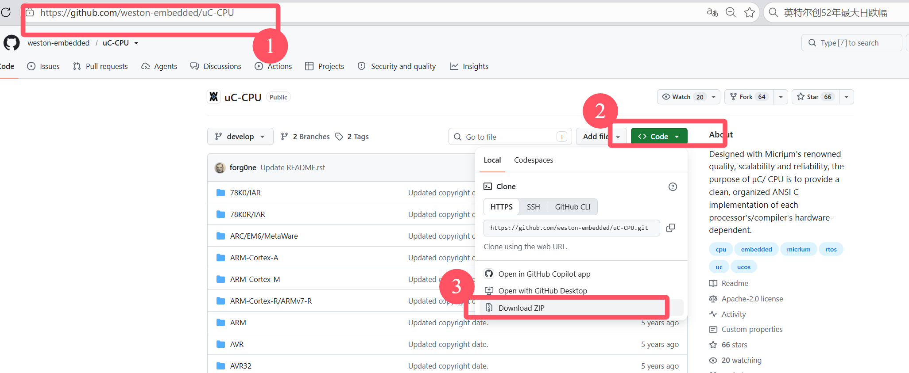

*图 6　GitHub 下载 uC-CPU*

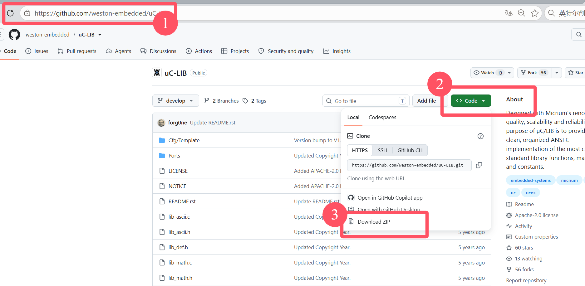

*图 7　GitHub 下载 uC-LIB*

三个压缩包都解压、改名后，`third_party` 下应并排出现三个源码目录：

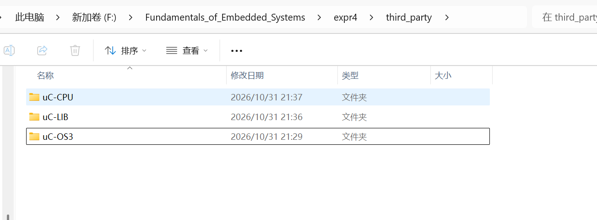

*图 8　三个源码目录整理完成*


### 5.2 用 PowerShell 复制到工程

本次移植没有采用“在资源管理器里把文件一个一个复制、粘贴到 Keil 目录”的传统方式，而是用 PowerShell 的 `New-Item`、`Copy-Item` 完成目录创建和源码复制。这样文件清单固定在命令里，不会漏文件，也不会因为手工拖拽把目录层级弄乱；换一台电脑时，把路径改一下就能重复整个移植过程。配置文件（`app_cfg.h`、`includes.h` 等）也用 PowerShell 直接生成，启动文件和数据手册中的固定修改同样可以用脚本完成。

以任务一为例：

```powershell
$proj = "F:\Fundamentals_of_Embedded_Systems\expr4\example_task1"
$refs = "F:\Fundamentals_of_Embedded_Systems\expr4\third_party"
$u    = "$proj\UCOSIII"

New-Item -ItemType Directory -Force `
  "$u\uC-CPU\ARM",`
  "$u\uC-LIB",`
  "$u\uC-OS3\Ports\ARM",`
  "$u\Config" | Out-Null

Copy-Item "$refs\uC-CPU\cpu_core.c",
          "$refs\uC-CPU\cpu_core.h",
          "$refs\uC-CPU\cpu_def.h" "$u\uC-CPU"
Copy-Item "$refs\uC-CPU\ARM-Cortex-M\ARMv7-M\cpu_c.c" "$u\uC-CPU"
Copy-Item "$refs\uC-CPU\ARM-Cortex-M\ARMv7-M\ARM\cpu.h",
          "$refs\uC-CPU\ARM-Cortex-M\ARMv7-M\ARM\cpu_a.asm" "$u\uC-CPU\ARM"

Copy-Item "$refs\uC-LIB\lib_*.c","$refs\uC-LIB\lib_*.h" "$u\uC-LIB"

Copy-Item "$refs\uC-OS3\Source\*" "$u\uC-OS3" -Recurse
Copy-Item "$refs\uC-OS3\Ports\ARM-Cortex-M\ARMv7-M\os_cpu_c.c" "$u\uC-OS3\Ports"
Copy-Item "$refs\uC-OS3\Ports\ARM-Cortex-M\ARMv7-M\ARM\os_cpu.h",
          "$refs\uC-OS3\Ports\ARM-Cortex-M\ARMv7-M\ARM\os_cpu_a.asm" "$u\uC-OS3\Ports\ARM"

Copy-Item "$refs\uC-OS3\Cfg\Template\os_cfg.h",
          "$refs\uC-OS3\Cfg\Template\os_cfg_app.h" "$u\Config"
Copy-Item "$refs\uC-CPU\Cfg\Template\cpu_cfg.h" "$u\Config"
Copy-Item "$refs\uC-LIB\Cfg\Template\lib_cfg.h" "$u\Config"
```

复制完成后，`UCOSIII` 下应有 `Config`、`uC-CPU`、`uC-LIB`、`uC-OS3` 四个目录。

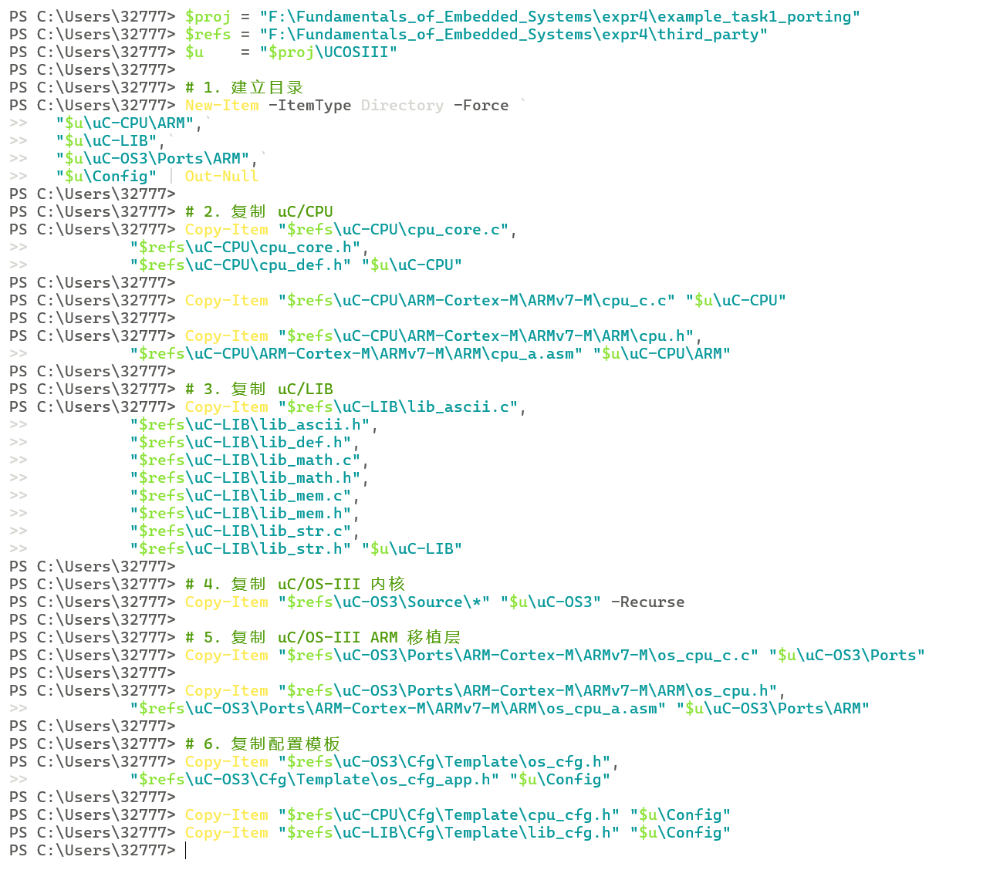

*图 9　PowerShell 复制 uC/OS-III 源码*

复制完成后，用 `Get-ChildItem` 检查，`UCOSIII` 下应有 `Config`、`uC-CPU`、`uC-LIB`、`uC-OS3` 四个目录，以及对应的移植文件：

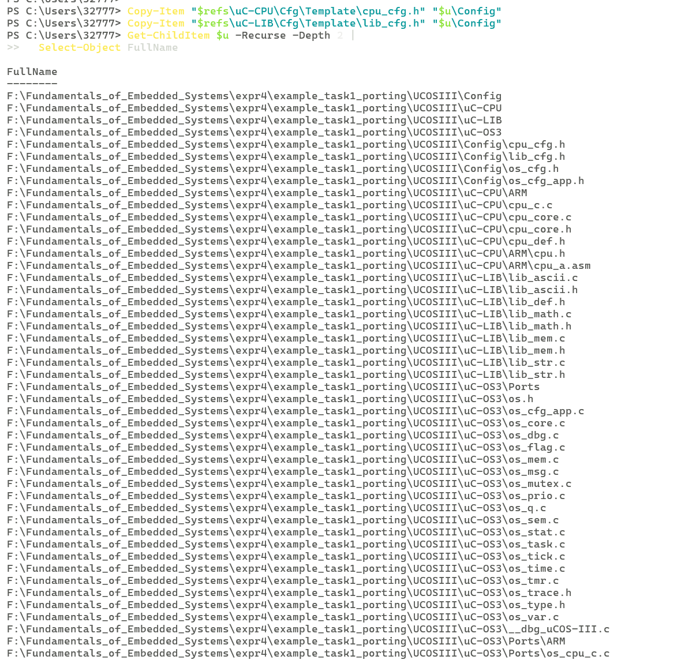

*图 10　复制完成后的 UCOSIII 目录检查*

回到工程根目录，也应看到新增的 `UCOSIII` 文件夹：

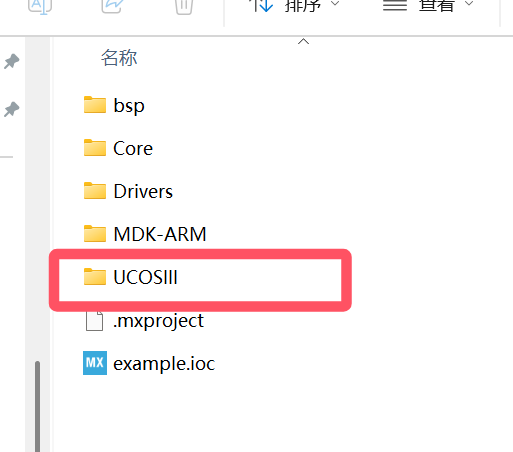

*图 11　工程根目录中的 UCOSIII 文件夹*

### 5.3 Keil 添加文件组

在 Keil 的 `Manage Project Items` 中新建四个组，并加入对应文件：

- `uC/CPU`：`cpu_core.c`、`cpu_c.c`、`cpu_a.asm`；
- `uC/LIB`：`lib_ascii.c`、`lib_math.c`、`lib_mem.c`、`lib_str.c`；
- `uC/OS-III Source`：`os_core.c`、`os_flag.c`、`os_mem.c`、`os_msg.c`、`os_mutex.c`、`os_prio.c`、`os_q.c`、`os_sem.c`、`os_stat.c`、`os_task.c`、`os_tick.c`、`os_time.c`、`os_tmr.c`、`os_var.c`、`os_cfg_app.c`；
- `uC/OS-III Ports`：`os_cpu_c.c`、`os_cpu_a.asm`。

`Options for Target → C/C++ → Include Paths` 加入：

```text
../Core/Inc
../bsp
../Drivers/STM32F1xx_HAL_Driver/Inc
../Drivers/STM32F1xx_HAL_Driver/Inc/Legacy
../Drivers/CMSIS/Device/ST/STM32F1xx/Include
../Drivers/CMSIS/Include
../UCOSIII/Config
../UCOSIII/uC-CPU
../UCOSIII/uC-CPU/ARM
../UCOSIII/uC-LIB
../UCOSIII/uC-OS3
../UCOSIII/uC-OS3/Ports
../UCOSIII/uC-OS3/Ports/ARM
```

宏定义保留：

```text
USE_HAL_DRIVER,STM32F103xB
```

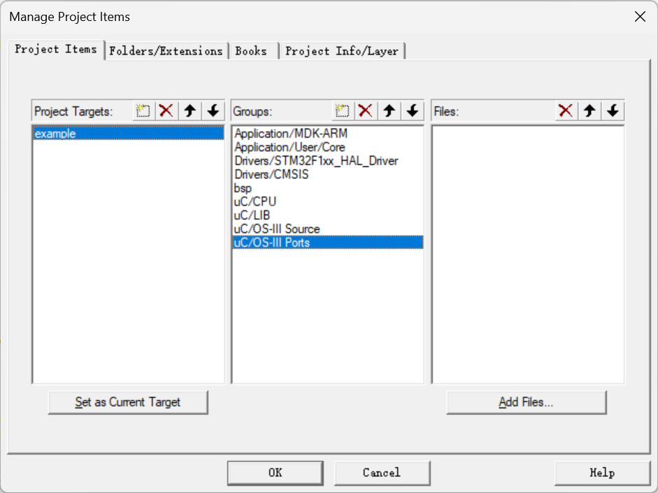

*图 12　Keil 中新建 uC/OS-III 文件组*

添加完成后，Project 树中应能看到 `uC/CPU`、`uC/LIB`、`uC/OS-III Source`、`uC/OS-III Ports` 四个组及对应文件：

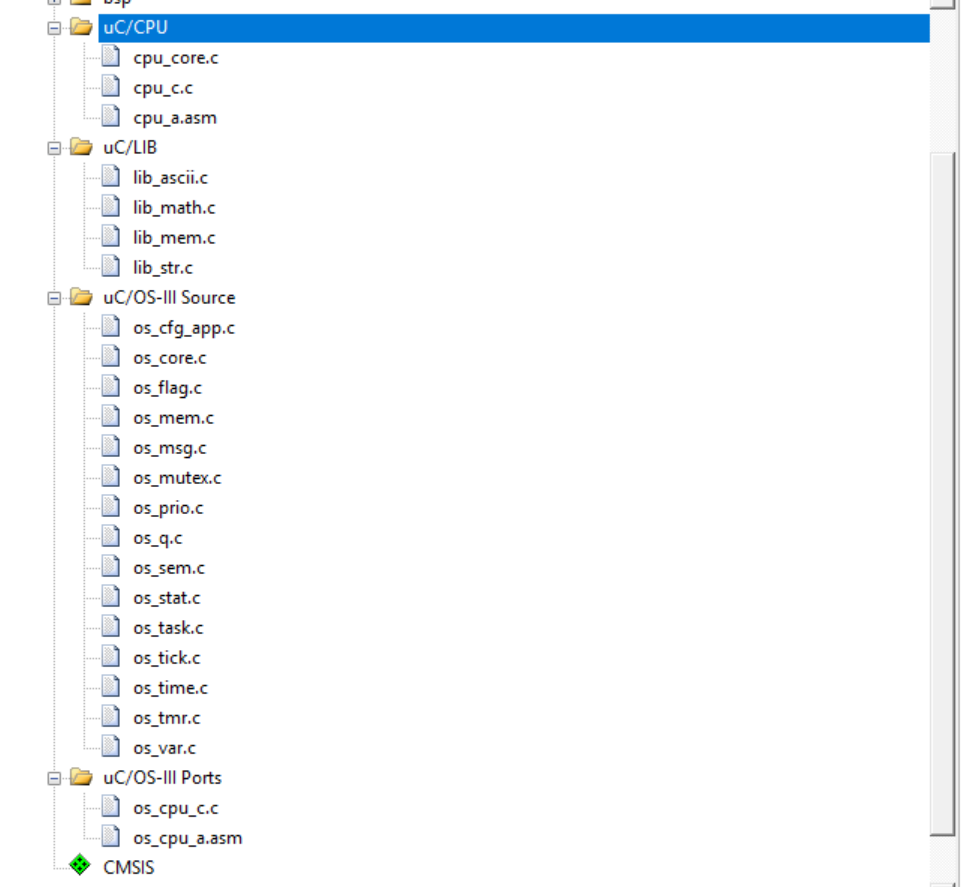

*图 13　文件组添加完成后的 Project 树*

### 5.4 修改 `os_cpu_c.c`

官方文件里是：

```c
#include  "../../../Source/os.h"
```

由于本工程把 `Source` 直接放在 `uC-OS3` 下，要改成：

```c
#include  <os.h>
```

### 5.5 修改启动文件 PendSV 向量

原启动文件：

```asm
DCD     PendSV_Handler             ; PendSV Handler
```

改为：

```asm
                IMPORT  OS_CPU_PendSVHandler

                DCD     OS_CPU_PendSVHandler       ; PendSV Handler
```

PendSV 必须直接指向汇编函数 `OS_CPU_PendSVHandler`。该汇编函数把 `LR` 当作 EXC_RETURN，不能用一个 C 函数再包一层。

### 5.6 修改 SysTick

在 `Core/Src/stm32f1xx_it.c` 中增加：

```c
#include "includes.h"
```

并保留 C 的 SysTick 入口，在里面同时处理 HAL 和 uC/OS-III：

```c
void SysTick_Handler(void)
{
    HAL_IncTick();
    OS_CPU_SysTickHandler();
}
```

原来的空 `PendSV_Handler()` 函数要删除，因为 PendSV 向量已经直接指向汇编处理程序。

### 5.7 关键配置

`app_cfg.h`：

```c
#ifndef APP_CFG_H
#define APP_CFG_H

#define APP_CFG_TASK_LED1_PRIO      4u
#define APP_CFG_TASK_LED2_PRIO      5u
#define APP_CFG_TASK_UART_PRIO      6u

#define APP_CFG_TASK_STK_SIZE       128u
#define APP_CFG_UART_STK_SIZE       256u

#endif
```

`includes.h`：

```c
#ifndef INCLUDES_H
#define INCLUDES_H

#include <stdio.h>
#include <string.h>

#include "os.h"
#include "cpu.h"
#include "lib_def.h"
#include "lib_ascii.h"
#include "lib_math.h"
#include "lib_mem.h"
#include "lib_str.h"

#include "app_cfg.h"
#include "main.h"
#include "gpio.h"
#include "usart.h"

#endif
```

`os_cpu.h` 中关闭 FPU 上下文：

```c
#define  OS_CPU_ARM_FP_EN              0u
```

`cpu_cfg.h` 中配置 4 位 NVIC 优先级：

```c
#define  CPU_CFG_NVIC_PRIO_BITS        4u
#define  CPU_CFG_KA_IPL_BOUNDARY       4u
```

`os_cfg.h` 主要裁剪如下：

```c
#define OS_CFG_APP_HOOKS_EN            0u
#define OS_CFG_ARG_CHK_EN              0u
#define OS_CFG_TICK_EN                 1u
#define OS_CFG_PRIO_MAX               32u
#define OS_CFG_STAT_TASK_EN            0u
#define OS_CFG_TMR_EN                  0u
#define OS_CFG_MEM_EN                  0u
#define OS_CFG_Q_EN                    0u
#define OS_CFG_SEM_EN                  0u
#define OS_CFG_MUTEX_EN                0u
#define OS_CFG_FLAG_EN                 0u
#define OS_CFG_TIME_DLY_HMSM_EN        1u
```

`os_cfg_app.h` 使用默认值即可：

```c
#define OS_CFG_TICK_RATE_HZ           1000u
#define OS_CFG_ISR_STK_SIZE            128u
#define OS_CFG_IDLE_TASK_STK_SIZE       64u
```

### 5.8 启动流程

`main.c` 完成 HAL、时钟、GPIO、USART 初始化后调用 `setup()`；`setup()` 在 `bsp/my_main.c` 中完成 `OSInit()`、创建任务和 `OSStart()`。

```c
HAL_Init();
SystemClock_Config();
HAL_SuspendTick();
MX_GPIO_Init();
MX_USART1_UART_Init();
setup();        /* 不会返回 */
```

`OS_CPU_SysTickInitFreq(SystemCoreClock)` 放在最高优先级任务 `led1_task` 的开头，等 `OSStart()` 之后再启动 OS 节拍。

### 5.9 编译验证

`example_task1` 编译结果：

```text
Program Size: Code=7724 RO-data=376 RW-data=60 ZI-data=5036
"example_task1\example_task1.axf" - 0 Error(s), 0 Warning(s).
```

---

## 6. 任务一代码与结果

三个任务的核心代码：

```c
/* 1 s LED */
HAL_GPIO_TogglePin(GPIOA, GPIO_PIN_5);
OSTimeDlyHMSM(0u, 0u, 1u, 0u, OS_OPT_TIME_HMSM_STRICT, &err);

/* 3 s LED */
HAL_GPIO_TogglePin(GPIOA, GPIO_PIN_6);
OSTimeDlyHMSM(0u, 0u, 3u, 0u, OS_OPT_TIME_HMSM_STRICT, &err);

/* 2 s 串口 */
HAL_UART_Transmit(&huart1, (uint8_t *)hello, sizeof(hello) - 1u, 1000u);
OSTimeDlyHMSM(0u, 0u, 2u, 0u, OS_OPT_TIME_HMSM_STRICT, &err);
```

串口字符串使用 GBK 编码，Windows 串口助手可以直接显示：

```text
hello uc/OS! 欢迎来到RTOS多任务环境！
```

实验现象：LED1 亮 1 s、灭 1 s；LED2 亮 3 s、灭 3 s；串口每 2 s 输出一行。三个任务互不阻塞。

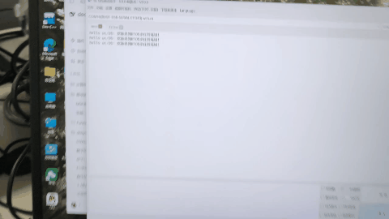

*图 14　任务一串口输出与运行效果*

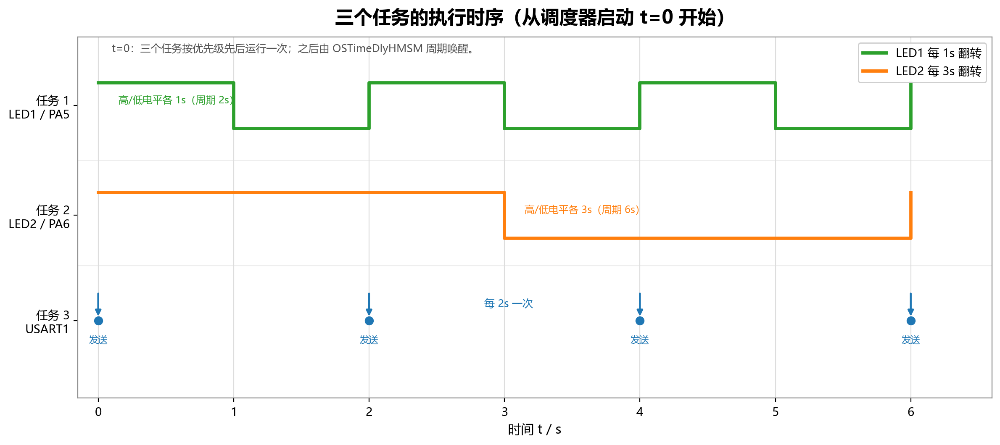

*图 15　三个任务的执行时序*

---

## 7. 任务二代码与结果

任务二沿用任务一的 OS 启动流程，只把第 3 个任务从 `uart_task` 改成 `aht20_task`。任务主体如下：

```c
static void aht20_task(void *p_arg)
{
    char    msg[64];
    int32_t temp_x10, humi_x10, temp_abs;
    OS_ERR  err;

    (void)p_arg;
    AHT20_Init();

    for (;;) {
        AHT20_Read(&temp_x10, &humi_x10);

        temp_abs = (temp_x10 < 0) ? -temp_x10 : temp_x10;
        sprintf(msg, "T=%s%ld.%ld C, H=%ld.%ld %%RH\r\n",
                (temp_x10 < 0) ? "-" : "",
                (long)(temp_abs / 10), (long)(temp_abs % 10),
                (long)(humi_x10 / 10), (long)(humi_x10 % 10));

        HAL_UART_Transmit(&huart1, (uint8_t *)msg, strlen(msg), 1000u);
        OSTimeDlyHMSM(0u, 0u, 2u, 0u, OS_OPT_TIME_PERIODIC, &err);
    }
}
```

实验现象：

- LED1 仍然每 1 s 翻转，LED2 仍然每 3 s 翻转；
- USART1 每 2 s 输出一次温度、湿度，例如：

```text
T=25.6 C, H=48.3 %RH
```

- AHT20 采集期间 LED 任务仍能正常调度，说明采集任务没有阻塞其它任务；
- `example_task2` 编译结果：

```text
Program Size: Code=9348 RO-data=336 RW-data=60 ZI-data=5036
"example_task2\example_task2.axf" - 0 Error(s), 0 Warning(s).
```

---

## 8. 软件 I2C 与硬件 I2C

I2C 使用 SCL 和 SDA 两根线，均为开漏结构，需要上拉电阻。通信过程包括 START、7 位地址 + 读写位、ACK/NACK、数据字节和 STOP。

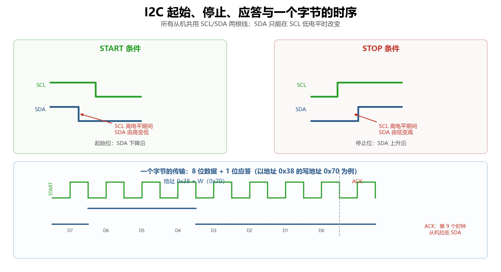

*图 16　I2C 起始、停止、应答与一个字节时序*

软件 I2C 是用 CPU 翻转 GPIO 来模拟 SCL/SDA；硬件 I2C 是使用 STM32 片内的 I2C 外设自动产生时序。

软件 I2C 的优点是引脚可任选、接线灵活、便于调试；缺点是占用 CPU、速率较低。硬件 I2C 的优点是速率高、CPU 占用低；缺点是引脚固定，STM32F1 的硬件 I2C 还存在一些已知 errata，调试成本较高。本实验 AHT20 速率要求不高，因此使用 PB6/PB7 软件 I2C。

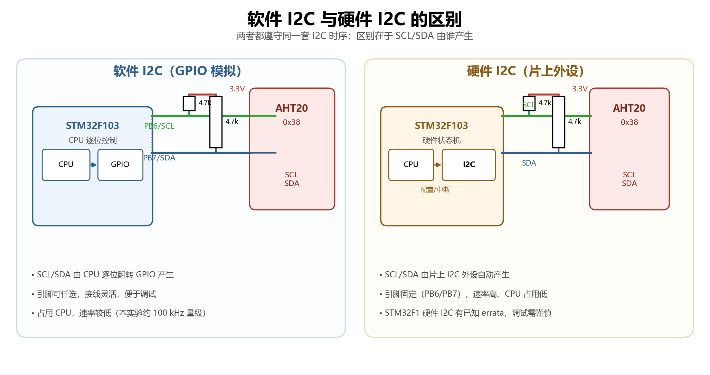

*图 17　软件 I2C 与硬件 I2C 对比*

参考资料：

- 野火《STM32F103 开发指南》第 23 章“I2C——读写 EEPROM”；
- [I2C 协议框图与通信过程](https://news.eeworld.com.cn/mcu/ic556426.html)；
- [立创开发板 I2C 实验](https://wiki.lckfb.com/zh-hans/lspi/beginner/i2c.html)；
- [AHT20 模块说明](https://openkits-wiki.easyeda.com/zh-hans/lspi/module/sensor/aht20-temperature-and-humidity-sensor.html)。

---

## 9. AHT20 驱动

AHT20 的 7 位地址是 **0x38**，写地址为 **0x70**，读地址为 **0x71**。供电范围 2.2～5.5 V，本实验使用 3.3 V。

初始化命令：

```text
START → 0x70 → 0xBE → 0x08 → 0x00 → STOP
```

触发测量：

```text
START → 0x70 → 0xAC → 0x33 → 0x00 → STOP
```

等待至少 80 ms 后读取 7 个字节：

```text
状态 + 湿度20位 + 温度20位 + CRC
```

软件 I2C 的关键函数：

```c
static void I2C_Start(void)
{
    SDA_H(); SCL_H(); I2C_Delay();
    SDA_L(); I2C_Delay();
    SCL_L(); I2C_Delay();
}

static void I2C_Stop(void)
{
    SDA_L(); SCL_H(); I2C_Delay();
    SDA_H(); I2C_Delay();
}
```

AHT20 初始化和读取：

```c
void AHT20_Init(void)
{
    HAL_Delay(100);

    I2C_Start();
    I2C_WriteByte(0x70);
    I2C_WriteByte(0xBE);
    I2C_WriteByte(0x08);
    I2C_WriteByte(0x00);
    I2C_Stop();

    HAL_Delay(10);
}

void AHT20_Read(int32_t *temp_x10, int32_t *humi_x10)
{
    uint8_t  buf[7];
    uint32_t raw_h, raw_t;
    uint8_t  i;

    I2C_Start();
    I2C_WriteByte(0x70);
    I2C_WriteByte(0xAC);
    I2C_WriteByte(0x33);
    I2C_WriteByte(0x00);
    I2C_Stop();

    HAL_Delay(80);

    I2C_Start();
    I2C_WriteByte(0x71);
    for (i = 0; i < 6u; i++) {
        buf[i] = I2C_ReadByte(1u);
    }
    buf[6] = I2C_ReadByte(0u);
    I2C_Stop();

    raw_h = ((uint32_t)buf[1] << 12) | ((uint32_t)buf[2] << 4) | (buf[3] >> 4);
    raw_t = (((uint32_t)buf[3] & 0x0Fu) << 16) | ((uint32_t)buf[4] << 8) | buf[5];

    *humi_x10 = (int32_t)((raw_h * 1000u) / 1048576u);
    *temp_x10 = (int32_t)((raw_t * 2000u) / 1048576u) - 500;
}
```

RTOS 中的第 3 个任务：

```c
static void aht20_task(void *p_arg)
{
    char    msg[64];
    int32_t temp_x10, humi_x10, temp_abs;
    OS_ERR  err;

    (void)p_arg;
    AHT20_Init();

    for (;;) {
        AHT20_Read(&temp_x10, &humi_x10);

        temp_abs = (temp_x10 < 0) ? -temp_x10 : temp_x10;
        sprintf(msg, "T=%s%ld.%ld C, H=%ld.%ld %%RH\r\n",
                (temp_x10 < 0) ? "-" : "",
                (long)(temp_abs / 10), (long)(temp_abs % 10),
                (long)(humi_x10 / 10), (long)(humi_x10 % 10));

        HAL_UART_Transmit(&huart1, (uint8_t *)msg, strlen(msg), 1000u);
        OSTimeDlyHMSM(0u, 0u, 2u, 0u, OS_OPT_TIME_PERIODIC, &err);
    }
}
```

串口输出形如：

```text
T=25.6 C, H=48.3 %RH
```

---

## 10. I2C 时序分析

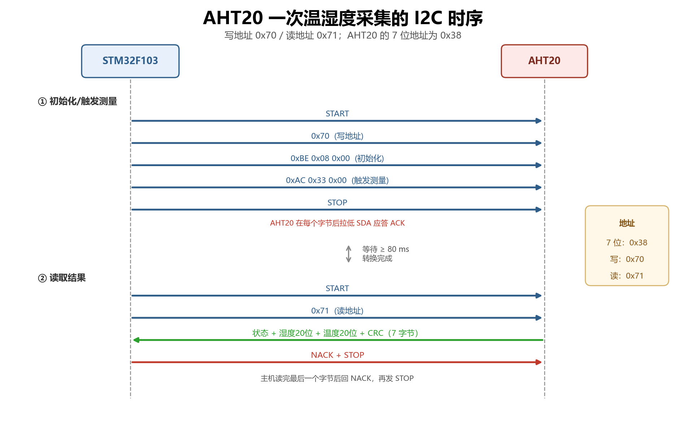

*图 18　AHT20 一次温湿度采集时序*

一次 AHT20 采集分两段：

1. 写阶段：START → 0x70 → `0xBE 0x08 0x00` 或 `0xAC 0x33 0x00` → STOP；
2. 等待至少 80 ms；
3. 读阶段：START → 0x71 → 7 个字节 → NACK → STOP。

每个字节占 9 个 SCL 时钟：8 个数据位 + 1 个 ACK 位。数据在 SCL 低电平时改变，在 SCL 高电平时被采样。

AHT20 的地址和命令可以总结为：

- 7 位地址：**0x38**；
- 写地址：**0x70**；
- 读地址：**0x71**；
- 初始化命令：`0xBE 0x08 0x00`；
- 触发测量命令：`0xAC 0x33 0x00`；
- 读取：发送 0x71，读 7 字节。

如果没有实物示波器，可以用 Keil 软件仿真加 Logic Analyzer 观察软件 I2C 的变量变化。Keil 仿真不会模拟真实 AHT20 从机，因此主要观察 MCU 发出的 START、地址、命令和时钟时序。

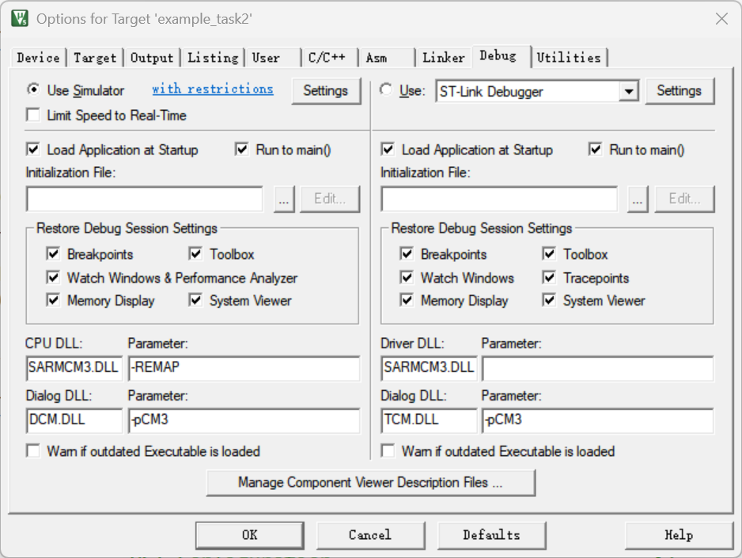

*图 19　Keil 软件仿真设置*

---

## 11. 实验结果与总结

任务一：

- LED1 每 1 s 翻转一次；
- LED2 每 3 s 翻转一次；
- USART1 每 2 s 输出一次指定字符串；
- 两个 LED 与串口互不阻塞。

任务二：

- 串口每 2 s 输出一次温度和湿度；
- LED 任务仍正常运行；
- `example_task2` 编译结果为：

```text
Program Size: Code=9348 RO-data=336 RW-data=60 ZI-data=5036
"example_task2\example_task2.axf" - 0 Error(s), 0 Warning(s).
```

通过本实验，掌握了 uC/OS-III 的源码组织、启动文件修改、SysTick 处理、任务创建和 I2C 传感器驱动方法，理解了软件 I2C 与硬件 I2C 的取舍，也理解了 AHT20 的地址、初始化命令和读写时序。

---

## 12. 实验体会

这次实验做下来，最大的感受是：移植 uC/OS-III 并不是把源码“拷进工程”就结束了，真正花时间的是启动文件、SysTick、NVIC 优先级和配置文件这些看起来不起眼的地方。最开始我也觉得在资源管理器里复制粘贴最省事，但文件一多就容易漏，目录层级也容易错。后来改用 PowerShell 的 `New-Item`、`Copy-Item` 把目录和文件清单写成命令，每次执行结果都一样，出了问题也能从命令反查是哪一步漏了。对我来说，这比“手快”更可靠，也更像真正做工程。

印象最深的是 PendSV 和 SysTick。PendSV 向量必须直接指向汇编处理程序，不能用一个 C 函数去调用它；SysTick 又要在 HAL 和 uC/OS-III 之间分工，OS 启动前不能让它提前进入内核。还有 Cortex-M3 没有 FPU，`OS_CPU_ARM_FP_EN` 必须关掉；STM32F103 是 4 位 NVIC 优先级，内核感知边界也要对应。这些问题单独看都只是“改一个宏”，但组合起来就是程序能不能跑起来的分水岭。

任务二让我对“协议”有了更具体的认识。软件 I2C 虽然速率不高，但 SCL/SDA 的每一位都能自己控制，START、地址、ACK、STOP 都能在波形上对上；AHT20 的地址 0x38、初始化 `0xBE 0x08 0x00`、测量 `0xAC 0x33 0x00`，以及 80 ms 的转换等待，只有自己写一遍才记得住。硬件 I2C 省 CPU，但 STM32F1 的 errata 和固定引脚也让我明白，没有哪种方式绝对更好，要看具体场合。

最后是 RTOS 和裸机的区别。裸机里一个 `HAL_Delay` 就会把整个程序卡住；在 uC/OS-III 里，LED 任务和 AHT20 任务各自延时，串口发送时其它任务仍能运行。RTOS 并不会让代码“跑得更快”，它真正解决的是“一个任务阻塞时，别让整个系统跟着等”。想清楚这一点，再看任务优先级、栈大小和系统节拍，就不只是背 API 了。

---

## 附录：参考资料

1. STM32F103C8T6 移植 uC/OS-III 基于 HAL 库：  
   <https://blog.csdn.net/weixin_43116606/article/details/105532222>
2. uC/OS-III 移植教程：  
   <https://blog.csdn.net/junseven164/article/details/121534916>
3. uC/OS-III 移植踩坑总结：  
   <https://blog.csdn.net/qq_45659777/article/details/121570886>
4. uC/OS-III 官方源码：  
   <https://github.com/weston-embedded/uC-OS3>
5. uC/CPU 官方源码：  
   <https://github.com/weston-embedded/uC-CPU>
6. uC/LIB 官方源码：  
   <https://github.com/weston-embedded/uC-LIB>
7. AHT20 产品手册：`expr4/AHT20产品手册a2.pdf`
8. AHT20 厂商 Demo：`expr4/AHT20-21 DEMO V1_3/`
9. I2C 协议框图与通信过程：  
   <https://news.eeworld.com.cn/mcu/ic556426.html>
10. 立创开发板 I2C 实验：  
    <https://wiki.lckfb.com/zh-hans/lspi/beginner/i2c.html>
11. AHT20 模块说明：  
    <https://openkits-wiki.easyeda.com/zh-hans/lspi/module/sensor/aht20-temperature-and-humidity-sensor.html>
